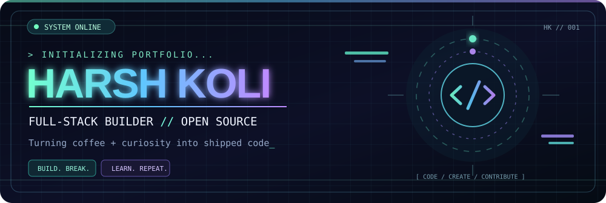

<!--
  HARSH KOLI — NEON ORBIT
  Personalized for @harshkoli1255; contact information intentionally omitted.
  Custom SVG assets are stored in /assets and animated in supported browsers.
-->
<div align="center">



<br />

<a href="https://git.io/typing-svg"></a>

<br />

<a href="https://github.com/harshkoli1255?tab=followers"></a>
<a href="https://github.com/harshkoli1255"></a>
<a href="https://github.com/harshkoli1255?tab=repositories"></a>

</div>

##  About me


- 👋 I'm **Harsh Koli** — a developer who loves building and experimenting.
- 🚀 I work with **C++, Python, JavaScript, TypeScript, React, Node.js, Go** and more.
- 🌱 Currently sharpening my **DSA, backend engineering, and open-source** skills.
- 🔭 Interested in **developer tools, useful web applications, and AI-powered projects**.
- ⚡ My philosophy: **Build → Break → Learn → Improve → Repeat.**

<br clear="both" />

<div align="center">

</div>

## ⚡ Tech universe

<div align="center">

</div>

## 🛰️ Currently exploring

```text
   ╭─────────────────────────────── MISSION CONTROL ───────────────────────────────╮
   │                                                                              │
   │   [01]  Data Structures & Algorithms         █████████████░░░   KEEP GOING  │
   │   [02]  Open Source Contributions            ███████████░░░░░   BUILDING    │
   │   [03]  Full-Stack Web Development            █████████████░░░   SHIPPING    │
   │   [04]  Backend Systems & Developer Tools     █████████░░░░░░░   LEARNING    │
   │                                                                              │
   ╰──────────────────────────────────────────────────────────────────────────────╯
```

> The bars above are illustrative, not measured progress.

## 🛠️ Things I've been building

<table>
<tr>
<td width="50%" valign="top">
<h3>🥗 ZeroPlate AI</h3>
<p>Smart food waste reduction and food redistribution platform connecting kitchens, NGOs, and delivery partners.</p>
<a href="https://zero-plate-ai.vercel.app/"></a>
</td>
<td width="50%" valign="top">
<h3>🧩 Open-source journey</h3>
<p>Learning in public through issues, pull requests, debugging, and collaborating on real-world developer projects.</p>
<a href="https://github.com/harshkoli1255?tab=repositories"></a>
</td>
</tr>
</table>

### 🌦️ Weatherwise

A full-stack intelligent weather platform built with Next.js and Gemini AI, including real-time information, AI summaries, and customizable alerts.  
[Explore Weatherwise →](https://github.com/harshkoli1255/Weatherwise)

### 📟 JioFiberCLI & DSA

- [JioFiberCLI](https://github.com/harshkoli1255/JioFiberCLI) — Python project.
- [DSA](https://github.com/harshkoli1255/DSA) — my C++ data structures and algorithms practice.
- [WEB_DEV-Projects](https://github.com/harshkoli1255/WEB_DEV-Projects) — my web-development work.

## 📊 GitHub telemetry

<div align="center">


<br />

</div>

## 🐍 My commits have a life of their own

<div align="center">
<!-- Available after you enable GitHub Actions and run the snake.yml workflow once. -->

</div>

## 🤝 Connect with me

Find me on GitHub. Other contact links can be added when I choose to share them publicly.


<div align="center">
<a href="https://github.com/harshkoli1255"></a>
</div>

<div align="center">
<br />

<br /><br />

</div>
