<!--
  HARSH KOLI — CYBER AURORA PROFILE
  Tailored for @harshkoli1255
  Optimized with hardware-accelerated SVG animations, high-contrast typography, and live telemetry widgets.
-->

<div align="center">

<!-- Animated Futuristic Neon Hero Banner -->


<br /><br />

<!-- Dynamic Animated Typing Header -->
<a href="https://github.com/harshkoli1255">
  
</a>

<br />

<!-- Interactive Glass Badges -->
<a href="https://github.com/harshkoli1255?tab=followers">
  
</a>
<a href="https://github.com/harshkoli1255?tab=repositories">
  
</a>
<a href="https://github.com/harshkolicool/Attendify">
  
</a>
<a href="https://komarev.com/ghpvc/?username=harshkoli1255&label=PROFILE+VIEWS&color=00F5D4&style=for-the-badge&labelColor=080E1C">
  
</a>

</div>

<br />

---

## 👨‍💻 About Me


- 🚀 **Full-Stack & Systems Builder** — Crafting resilient distributed applications, high-performance backends, and responsive modern frontends.
- 🎓 **Creator of Attendify** — An enterprise zero-proxy smart attendance platform powered by ultrasonic audio DSP, WebAuthn biometrics, and GPS geofencing.
- 🔭 **Open-Source Contributor** — Actively contributing to the cloud-native ecosystem, including **[OpenTelemetry Collector Contrib](https://github.com/open-telemetry/opentelemetry-collector-contrib)**.
- 🌱 **Deepening Core CS** — Sharpening algorithmic mastery with **C++ (DSA)**, concurrency primitives, and microservice clustering.
- ⚡ **Engineering Creed** — *"Clean abstractions, verifiable performance, zero fluff."*

<br clear="both" />

<br />

<div align="center">

<!-- Interactive Animated Developer Terminal -->


</div>

<br />

---

## 🏆 Featured Flagship: Attendify

<div align="center">

<!-- Attendify Animated Banner -->


</div>

### 🎓 **[Attendify — Enterprise Zero-Proxy Smart Attendance](https://github.com/harshkolicool/Attendify)**

> *A next-generation multi-tenant campus attendance platform engineered to eliminate buddy-punching and proxy attendance entirely through multi-factor physical verification.*

```
      ┌────────────────────────────────────────────────────────────────────────┐
      │                     3-LAYER VERIFICATION MATRIX                         │
      │                                                                        │
      │   [1] 🔊 Ultrasonic Acoustic DSP   ──► Physical room soundwave presence│
      │   [2] 🔐 FIDO2 WebAuthn Passkeys   ──► Device-bound biometric auth     │
      │   [3] 🛰️ Live Classroom GPS Radar  ──► Real-time Socket.IO geofence    │
      └────────────────────────────────────────────────────────────────────────┘
```

#### 🌟 Key Architectural Innovations:
- **🔊 Ultrasonic Acoustic Beacon (Web Audio API)**: Broadcasts inaudible 19.5 kHz MFSK soundwave chords from the teacher's podium; student devices decode room presence via a 2048-point Fast Fourier Transform (FFT).
- **🔐 Biometric Passkeys (WebAuthn / FIDO2)**: Bound directly to hardware authenticators (Touch ID, Face ID, Windows Hello) — renders credentials unexportable and makes proxy attendance impossible.
- **🛰️ Live Classroom Radar (Socket.IO + Leaflet)**: Real-time map displaying student GPS coordinates with live color-coded verification badges (*Ultrasonic*, *Passkey*, *Inside*, *Outside*).
- **⚡ Production Node.js Cluster + Redis Queue**: Multi-core worker cluster with Redis Pub/Sub and 50-item batch write queues, verified with **23/23 passing automated tests**.

<div align="center">
  <a href="https://github.com/harshkolicool/Attendify">
    
  </a>
  <a href="https://github.com/harshkolicool/Attendify#readme">
    
  </a>
  
</div>

<br />

---

## 🛠️ Flagship Projects & Open Source

<table>
<tr>
<td width="50%" valign="top">

### 🛡️ [ExtensionShield](https://github.com/harshkoli1255/ExtensionShield)
Chrome extension risk scanner &amp; security/privacy auditor. Scans Chrome Web Store links or CRX/ZIP builds to generate evidence-based security reports.
<br /><br />


<br />
<a href="https://github.com/harshkoli1255/ExtensionShield"><b>Inspect Security Engine →</b></a>

</td>
<td width="50%" valign="top">

### 🌦️ [Weatherwise](https://github.com/harshkoli1255/Weatherwise)
Intelligent full-stack weather intelligence platform built with Next.js and Google Gemini AI, featuring real-time meteorological telemetry and AI alert summaries.
<br /><br />


<br />
<a href="https://github.com/harshkoli1255/Weatherwise"><b>Launch Weatherwise →</b></a>

</td>
</tr>

<tr>
<td width="50%" valign="top">

### 🔭 [OpenTelemetry Collector Contrib](https://github.com/harshkoli1255/opentelemetry-collector-contrib)
Active contributor to the CNCF OpenTelemetry collector repository. Working on cloud-native observability, distributed tracing receivers, and exporters.
<br /><br />


<br />
<a href="https://github.com/harshkoli1255/opentelemetry-collector-contrib"><b>View Contributions →</b></a>

</td>
<td width="50%" valign="top">

### ⚡ [DSA Mastery & Algorithms](https://github.com/harshkoli1255/DSA)
Comprehensive C++ repository of data structures, graph theory algorithms, dynamic programming solutions, and competitive problem-solving patterns.
<br /><br />


<br />
<a href="https://github.com/harshkoli1255/DSA"><b>Browse Solutions →</b></a>

</td>
</tr>
</table>

<br />

---

## ⚡ Tech Universe

<div align="center">

<!-- Curated Skill Icons in Dark Neon Mode -->


</div>

<br />

<table align="center">
  <tr>
    <td align="center"><b>Core &amp; Systems</b></td>
    <td><code>C++</code> • <code>C</code> • <code>Python</code> • <code>Go</code> • <code>Java</code> • <code>DSA &amp; OOP</code></td>
  </tr>
  <tr>
    <td align="center"><b>Frontend &amp; UI</b></td>
    <td><code>React</code> • <code>Next.js</code> • <code>TypeScript</code> • <code>TailwindCSS</code> • <code>HTML5/CSS3</code></td>
  </tr>
  <tr>
    <td align="center"><b>Backend &amp; DB</b></td>
    <td><code>Node.js</code> • <code>Express 5</code> • <code>MongoDB Atlas</code> • <code>PostgreSQL</code> • <code>Redis</code></td>
  </tr>
  <tr>
    <td align="center"><b>DevOps &amp; Infra</b></td>
    <td><code>Docker</code> • <code>Git &amp; GitHub Actions</code> • <code>Linux</code> • <code>Cluster &amp; PM2</code> • <code>OpenTelemetry</code></td>
  </tr>
</table>

<br />

---

## 🛰️ Mission Control Status HUD

```text
   ╭────────────────────────────── MISSION CONTROL HUD ──────────────────────────────╮
   │                                                                                 │
   │   [01]  Attendify (Acoustic & Biometric)       ████████████████   [V2.0 SHIPPED]│
   │   [02]  OpenTelemetry Observability (CNCF)     ████████████░░░░   [CONTRIBUTING]│
   │   [03]  High-Performance Systems & DSA         █████████████░░░   [LEVELING UP] │
   │   [04]  Full-Stack Cloud & Microservices       ██████████████░░   [ARCHITECTING]│
   │                                                                                 │
   ╰─────────────────────────────────────────────────────────────────────────────────╯
```

<br />

---

## 📊 GitHub Telemetry

<div align="center">

<!-- GitHub Readme Stats with Custom Cyber-Aurora Palette -->
<a href="https://github.com/harshkoli1255">
  
</a>
<a href="https://github.com/harshkoli1255">
  
</a>

<br /><br />

<!-- GitHub Streak Stats with Matching Neon Colors -->
<a href="https://github.com/harshkoli1255">
  
</a>

</div>

<br />

---

## 🐍 Contribution Ecosystem

<div align="center">

<!-- GitHub Contribution Snake Animation -->


</div>

<br />

---

## 🤝 Connect & Collaborate

<div align="center">

<a href="https://github.com/harshkoli1255">
  
</a>
<a href="https://linkedin.com/in/">
  
</a>
<a href="mailto:harshkoli1255@gmail.com">
  
</a>

<br /><br />

<!-- Animated Ambient Footer -->


</div>
