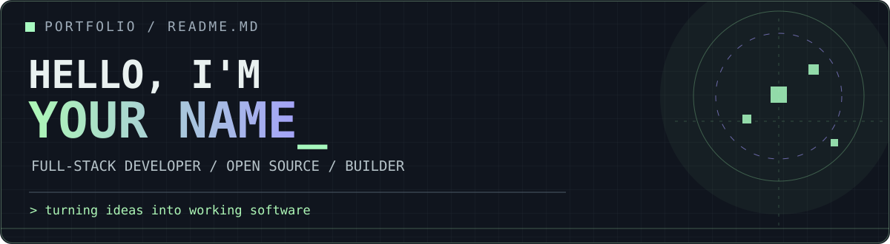

<div align="center">
  

  <br />

  

  <p>
    <a href="https://github.com/USERNAME?tab=followers"></a>
    
    
  </p>
</div>

<!-- ABOUT -->
<table>
<tr>
<td width="60%" valign="top">

### `01 / WHO AM I?`

Hey, I'm **Harsh Koli** — a developer and technology student at **Mirai School of Technology**.

I enjoy turning an idea into something people can actually use. From full-stack apps to open-source contributions, I like learning how systems work and making them better.

- `> focus` &nbsp; Full-stack development & open source
- `> exploring` &nbsp; AI, developer tools & scalable systems
- `> philosophy` &nbsp; Build. Break. Learn. Improve.
- `> location` &nbsp; India 🇮🇳

</td>
<td width="40%" valign="top">

### `02 / CURRENTLY` 

```text
┌─ developer.log ───────────┐
│ STATUS   : LEARNING      │
│ MODE     : SHIPPING      │
│ FUEL     : CURIOSITY     │
│ BUGS     : IN PROGRESS   │
│ GOAL     : GET BETTER    │
└──────────────────────────┘
```

</td>
</tr>
</table>

### `03 / TECH ARSENAL`

<div align="center">

**Languages**


**Frontend & Mobile**


**Backend, Databases & Tools**


</div>

### `04 / FEATURED BUILDS`

<table>
<tr>
<td width="50%" valign="top">

**🍃 ZeroPlate AI**

A smart food-waste reduction and redistribution platform connecting kitchens, NGOs, and delivery partners.

`Food rescue` · `Full-stack` · `AI concepts`

[**Explore live project ↗**](https://zero-plate-ai.vercel.app/)

</td>
<td width="50%" valign="top">

**🔭 Open-Source Journey**

Exploring real-world codebases and working on issues, fixes, and pull requests across developer tools and infrastructure projects.

`GitHub` · `Jaeger` · `Collaboration`

[**View my repositories ↗**](https://github.com/USERNAME?tab=repositories)

</td>
</tr>
</table>

### `05 / GITHUB TELEMETRY`

<div align="center">
  
  

  
</div>

### `06 / CONTRIBUTION TRAIL`

<!-- Optional: enable the GitHub Action supplied in .github/workflows/snake.yml, then uncomment this line. -->
<!-- <picture><source media="(prefers-color-scheme: dark)" srcset="https://raw.githubusercontent.com/USERNAME/USERNAME/output/github-contribution-grid-snake-dark.svg" /></picture> -->

> **Good code is written. Better code is improved.**

### `07 / LET'S CONNECT`

<div align="center">
  <a href="https://www.linkedin.com/in/LINKEDIN_ID/"></a>
  <a href="https://github.com/USERNAME"></a>
  <a href="mailto:YOUR_EMAIL@example.com"></a>
  <a href="https://YOUR_PORTFOLIO_URL"></a>
</div>

<br />
<div align="center">
  <sub>⌁ built with curiosity · maintained with caffeine · improved one commit at a time ⌁</sub>
</div>
